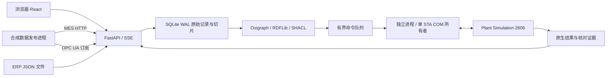

# 实现与模型契约

## 进程与执行边界

运行期间仅一个 COM 工作进程执行原生任务。该进程在同一 STA 初始化、创建、使用、释放 COM；FastAPI 和浏览器只交换普通数据。队列容量为 4，三方案串行执行。暂停、取消由共享事件标志传递，在原生调用可返回的事件边界生效；不能中断任意阻塞 COM RPC。模型仅以数值参数和内部生成的对象名调用固定 SimTalk 模板。

创建实例前记录进程清单，以 `GetCurrentProcessId()` 核实新实例归属，保存进程创建时间。正常退出 `StopSimulation → Quit → CoUninitialize`。若关闭超过 20 秒，仅允许处理 PID、创建时间和进程名称均核对归属的实例；不按名称批量终止 Plant Simulation。

`SetNoMessageBox`、`NewModel()`、`ResetSimulation`、`StartSimulation`、`StepSimulation` 均经本机实际调用验证；事件控制器为 `.Models.Model.EventController`。执行许可、创建对象和保存模型已实际验证，未强制更改许可证类型或服务设置。

## 单一调度权威

Python 负责释放、路由、派工、班次与维护可用性；Plant Simulation 负责真实 MU、Station 加工完成和仿真时钟。每个完成事件必须读到原生 `MU.Finished`，核对实际 MU 名称后才更新控制状态。不存在 Python 仿真替代结果模式。

- 资源由 Frame、WaitingBuffer、Station 构成；成品进入原生 Drain。
- 固定转运将 MU 移入原生 Transit 缓冲区，并通过原生 `Method.executeIn()` 唤醒；等待到期后实际移动到下一设备。
- 单台设备单件加工。班末已开工工件继续完成；非班次不再开新工序。
- CNC 完工计数达到阈值，先完成该工序，再进入配置时长的维护；维护期间不派工。维护结束清零刀具计数。
- 随机样本由 `seed + 工件 ID + 工序序号` 的 SHA-256 映射生成，波动为标称工时的 ±8%。资源改派不重新采样，且未建模不同合格 CNC 的加工速度差异。
- 初始三个产品的首选 CNC 均为 CNC01，用于演示资格约束下的负荷重新分配。它是明确的合成基准，不代表客户车间现状。

## 数据隔离与一致切片

基准真实运行生成参考轨迹，完整轨迹放在 `.runtime/source-vault`。独立发布器持有未来轨迹，逐帧发送 MES 工件状态和 OPC UA 设备状态。MES 与 OPC UA 使用不同设备 ID，OPC 时间单位为毫秒。后台只有收到一个游标的 MES 以及全部六台设备的 OPC 观测，且单位、实体、位置和时间一致，才提交现场切片。

发布器等待后端提交确认再发送下一帧，因此订阅采样不会悄然跳过中间生产事件。断连后重试同一游标，后端以 `(project, source, raw_id)` 唯一键去重。异常记录进入待处理区。冻结等待发布器完成当前事务并确认暂停；未到齐时拒绝保存不一致快照。

预测输入由冻结切片、已知 ERP 计划和明确的预测样本组成，不读取未来参考轨迹。源码中后端将轨迹路径交给发布进程，但不会解析未发布轨迹作为预测数据。该隔离是本机受控 PoC 的进程与代码职责隔离，不是对本机管理员的访问控制系统。

## 五类接口

| 契约 | 含义 |
|---|---|
| ProductionSpec 1.0 | 资源与能力、工艺、订单、维护、班次、转运、种子与终点 |
| TwinSnapshot 1.0 | 现场状态、完整边界游标、来源游标、工件样本、配置与状态摘要 |
| ScenarioPatch 1.0 | FIFO/EDD、兼容改派、班次时长和限定到当前工序的单件改派 |
| RunResult 1.0 | 终态、时间窗、订单明细、生产事件、甘特区间和原生核对 |
| CheckpointManifest 1.0 | 组合存档文件哈希、快照、配置、事件边界与恢复方式 |

所有契约由 Pydantic 验证，禁止额外字段，数值必须有限；默认值也进行类型规范化，避免相同数值在 `8` 与 `8.0` 序列化时出现错误版本差异。

## 恢复与分支

组合存档包含配置、快照、样本、已接收帧与原始消息、语义 TriG、结果及已有的原生模型。`baseline-template.spp` 是执行前的原生结构模型，`restored.spp` 是经过恢复核对的原生现场，`final.spp` 是对应方案终态。原生模型需要 Python 控制器协同执行，单独打开 `.spp` 不会自动重建 Python 队列。

恢复会校验文件哈希，新建独立模型，以同一计划、样本和基准控制规则快进至快照边界，然后逐项比较：时钟（绝对容差 10⁻⁶ 秒）、工艺进度、工件位置、队列顺序、设备占用、刀具计数及维护结束时间。再以原生 MU 名称、队列成员、Station 占用及 Drain 计数核对。任何差异都会使任务失败，不能标记恢复成功。

首版保存的是受控基准现场；三个方案是独立预测分支，结果持久化。尚不支持任意第三方 Plant Simulation 模型的通用 checkpoint，也不支持在方案执行中间另存新的可继续分支。

## KPI

三个方案采用共同窗口 `[冻结时刻, 129600 秒]`，即基准配置的 36 小时终点。报告累计完工、窗口内完工、已完工订单与未完工订单分别计数；未完工订单的逾期不能伪装成已确定的最终延期。全部完工时间仅在全部完成时提供。

设备利用率 = 窗口内实际加工时长 / 窗口日历时长；不等同于 OEE。等待均值只统计窗口内开工的工序，并截断冻结前等待。平均在制以释放／完工事件做时间积分，终态在制另列。

## ASMG 与 LLM 后续衔接

本版没有 LLM。论文 OntologySim 的本体与运行状态、离散事件和多 Agent 思路在此采用受控中央调度策略重构，并非逐行复制原论文的 Owlready2 仿真引擎或完整复现其多 Agent 网络。

ASMG 已验证的 COM 建模和逐事件完成观测经验被复用。下一阶段自然语言只生成 `ProductionSpec` 或 `ScenarioPatch`，先经过 Pydantic、SHACL、能力与业务约束，再进入现有执行队列。LLM 可解释有证据的结果，不直接写 SimTalk、修改历史事实或替代原生 KPI。评价建模准备时间、无效方案拦截率、现场到结果用时及解释可追溯性。
