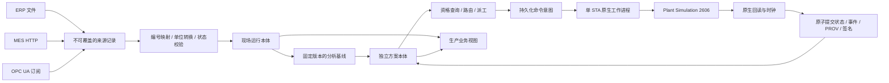

# V0.2 本体运行架构与模型契约

## 状态所有权

`app_v2/graph.py` 是生产状态的唯一提交入口。Oxigraph 中的设备、工件、执行活动、夹具预留、物料结存、待执行事件、时钟和策略都是有类型、有属性的 RDF 实体。Python 返回的字典只是查询视图，不能自行推进另一份完整生产状态。`OntologyRuntime` 仅持有 `graph`；测试直接检查这一点。

Plant Simulation 负责 MU、Waiting Buffer、Station、Transit Buffer、Drain 及 EventController。Python 在原生事件控制点查询本体、作出确定性决策、提交受限 COM 命令。没有 Python 仿真器替代原生运行。复用 V0.1 的 COM 所有权与 STA 生命周期代码，不复用 V0.1 的生产状态推进循环。

SQLite 只存本地账号和会话。任务、工作空间、基线索引和操作审计也存入独立的目录本体。前端状态、任务进度、已解析快照和待对齐消息缓冲可以丢弃；重启由 RDF、已接收原始记录和来源重传恢复。

## 提交与故障

每次提交保留事件序号、前序摘要、操作责任主体、真实时间、业务时间、输入对象及其确切版本、变更前后值、PROV 关系和签名。SPARQL 更新在同一事务中替换当前记录并追加历史，完成持久化后再发 SSE 通知。当前对象可以推进版本，旧活动与版本证据不能通过 API 覆盖。

COM 与 Oxigraph 不共享事务。执行前持久化 `Command(prepared)`；收到原生确认后，将业务变更与 `acknowledged` 一起提交。响应丢失时记录 `unknown`；原生确认后图提交失败则保留 `prepared`。这两种状态都使分支停止，并禁止直接续跑或重发。需要先核对原生状态与完整边界；本版不提供任意编辑“解除待核对”的接口。

事件按业务时间、固定优先级、稳定实体 ID 处理。同一时刻先消化原生完成与到期事件，再按设备顺序派工。班次外不新开工；已开工加工与换型可以跨越班次终点。维护在当前工序完成后开始。夹具在换型前预留，工序完成后释放。

## 快照与直接恢复

核心文件是 `runtime.trig`，包含：

- `graph/schema`：版本化应用本体。
- `graph/inference`：有限 OWL-RL TBox 闭包；不推导未观测的现场事实。
- `graph/state`：生产配置、现场／预测状态、样本算法与种子、队列、执行与待执行事件。
- `graph/evidence`：签名事件、不可变对象版本和 PROV-O 关系。

每个工作空间、基线和运行分支拥有独立 Store／TriG，图名称可以相同而存储边界独立。来源记录、映射、规则与预测活动用明确类型和活动区分。`ontology_contract` 的规范化模式摘要将本体定义和推理闭包绑定到签名历史。

恢复只加载 TriG：检查签名、状态与历史一致性、未确认命令及业务不变量；创建原生设备和 MU；按队列顺序装载；将活动的 `end_s - snapshot_time_s` 装载为剩余加工／换型时长；重建维护、转运、释放和班次事件。原生本地时钟从零开始，业务时间等于保存起点加原生时钟。**不从零回放，不读取 `result.json` 或隐藏的 JSON 状态来恢复。**

JSON 用于 API、签名规范化内容、ERP 原始文件和命令通信。审计日志内的 JSON delta 是历史证据；当前生产状态同时以显式 RDF 属性保存并与历史核对。UI 的 `result.json` 是可重建输出，不是状态权威。

## 现场与预测隔离

合成工厂先以 Plant Simulation 生成独立参考轨迹，保存在后端私有 source-vault。独立发布器通过实际 MES HTTP 和 OPC UA 发布已到达的事件。原始观测有来源编号、事件时间、接收时间、质量和摘要。预测 API 禁止读取生成器任务的未来轨迹。

“创建分析基线”固定一个已经完整提交的现场版本，不暂停接入。MES 和所有设备 OPC 观测属于同一个游标与时间切片才提交；断连后原游标重传，完全相同的消息去重，冲突不覆盖。迟到记录保留并形成新证据，不修改旧基线。

现场生成种子为 2606，预测默认种子为 5202。方案同一重复组使用同一 SHA-256 配对样本，键为种子、工件、工序、执行次数及样本用途；设备系数在配对扰动后应用。五组比较使用 5202–5206。加工时间为标准工时 × 设备系数 × [0.92, 1.08] 均匀扰动。检验使用独立用途的配对样本。

发布器不公开活动的未来实际结束时间或未来质量结果。在加工剩余时间按已知标准工时估计；若标准工时已被观测经过，则采用至少 1 秒的显式剩余时间假设。该边界及 `time_basis` 可在基线查看。此估计尚未用真实数据校准；原生仿真中途保存的活动则保留其真实已选总时长，恢复无需估计。

## KPI 定义

- 完工与报废是统计终点的累计数量；在制排除未投产、待料、完工、报废。
- 完工订单要求全部工件合格完成；未完工和含报废缺口的订单单列，不当作按期。
- 延期仅对已完工订单计算，交期取绑定的订单版本。
- 平均在制按时间积分，统计窗口为基线到配置终点。
- 利用率按加工时间 / 同一日历统计窗口计算，不是 OEE，不包括换型。
- 排队时间从队列进入到开工，截取统计窗口，同时包括终点仍在等待的工件；每件值以已投产工件数为分母。
- 原生核对记录业务／原生时钟、队列成员、设备占用、转运成员、Drain 完工／报废累计及会话 PID。恢复前累计计数与恢复后原生 Drain 计数分开保留。

## 受控模型边界

六台设备、单容量加工站、固定转运时长、产品族换型、有限共享夹具、非抢占维护、一次返工与复检。BOM 是单件毛坯消耗和重量差额，不支持装配齐套。质量结果按产品规则抽样，并关联原料批次；没有声称建立经过校准的原料质量因果模型。

LLM、ASMG、AGV、真实设备控制写回不在本版。将来可将 ASMG 输出接到 `ProductionSpec` 和 `ScenarioDefinition`，继续通过相同结构、语义校验和执行服务。
